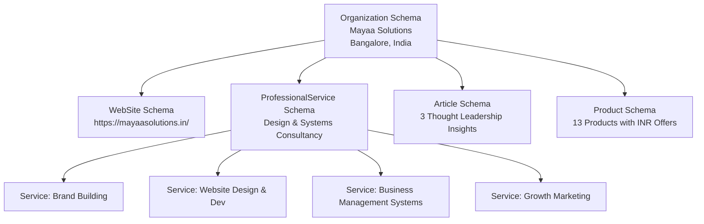
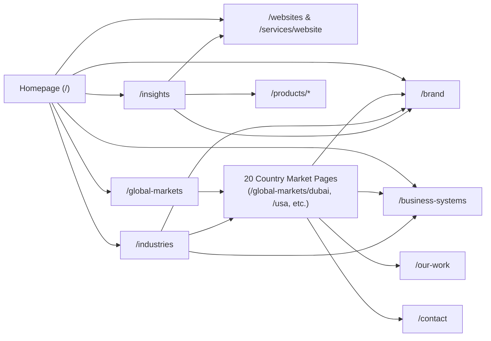

# MAYAA SOLUTIONS: GLOBAL WEBSITE TRANSFORMATION
# STEP 1: COMPLETE INTERNATIONAL SEO AUDIT & IMPLEMENTATION PLAN

**Target Domain:** https://mayaasolutions.in/  
**Audit Date:** October 2026  
**Auditor Role:** Senior Technical SEO Architect, International SEO Strategist, AEO/GEO Specialist & Full-Stack Website Auditor  
**Status:** Audit & Implementation Planning Phase (No Source Code / Design Changes Executed)

---

## EXECUTIVE SUMMARY & ARCHITECTURAL OVERVIEW

### 1.1 Architecture & Stack Identification
Mayaa Solutions is constructed as a **Single Page Application (SPA)** utilizing the following modern front-end stack:
- **Framework & Build System:** React 18.3.1, TypeScript 5.5.3, Vite 5.4.1.
- **Routing:** React Router DOM v6.26.1 (`<BrowserRouter>`).
- **Styling & Animation:** Tailwind CSS 3.4.10, Framer Motion 11.3.28, Lucide React 0.428.0.
- **Hosting & CI/CD:** GitHub Pages via GitHub Actions workflow (`.github/workflows/deploy.yml` pushing `./dist`).
- **Payment & Backend Integrations:** Cashfree Payments SDK v3 (INR checkout), Supabase for contact forms and storage.

---

### 1.2 Critical Technical Blockers Identified

1. **GitHub Pages SPA Routing Returns HTTP 404 to Search Bots on Deep Crawls**  
   - *Evidence:* In `public/404.html` and `.github/workflows/deploy.yml`, Vite builds a single `index.html` and static assets into `dist/`. When a user or search engine crawler (Googlebot, Bingbot, Baiduspider) directly requests any internal deep URL (e.g., `https://mayaasolutions.in/global-markets/dubai` or `https://mayaasolutions.in/brand`), GitHub Pages cannot find a static directory index and returns **HTTP 404 (Not Found)** with `404.html`.
   - *Consequence:* Although `404.html` contains the `spa-github-pages` JavaScript snippet redirecting the browser to `/?/global-markets/dubai`, most web search crawlers and social scrapers (LinkedIn, Twitter/X, WhatsApp) **do not execute JavaScript on 404 responses**. They record the page as a 404 error and drop it from indexing.

2. **Complete Absence of XML Sitemap (`sitemap.xml`)**  
   - *Evidence:* File searches across root and `public/` confirm no `sitemap.xml` exists.
   - *Consequence:* Search engines have no indexation map to discover the 20 country pages, services, articles, or product catalog.

3. **Complete Absence of Robots Directives (`robots.txt`)**  
   - *Evidence:* No `robots.txt` file exists in `public/` or the repository root.
   - *Consequence:* Search crawlers have no crawl guidelines and cannot discover the sitemap index.

4. **Client-Side-Only DOM Metadata Mutation (`SEO.tsx`)**  
   - *Evidence:* `src/components/SEO.tsx` modifies `document.title`, `document.querySelector('meta[name="description"]')`, Open Graph, and `<link rel="canonical">` exclusively inside a React `useEffect()` hook.
   - *Consequence:* Initial raw HTML in `index.html` serves generic homepage metadata:
     `Mayaa Solutions | Brands, Websites, Digital Products & Business Systems`.
     Crawlers that parse raw HTML without running full JS rendering pipelines receive the homepage title and description for all 58+ pages.

5. **Self-Referential Canonical Loop on Duplicate/Alias Routes**  
   - *Evidence:* `SEO.tsx` dynamically sets `currentUrl = "https://mayaasolutions.in" + location.pathname` without allowing custom canonical overrides.
   - *Consequence:* Route aliases like `/services/branding` and `/services/brand-building` render identical content to `/brand`, yet each declares **itself** as canonical. This creates internal duplicate content penalties and index fragmentation.

6. **Complete Absence of Structured Data (JSON-LD / Schema.org)**  
   - *Evidence:* Grep for `application/ld+json` or `schema.org` across all components returned 0 results.
   - *Consequence:* Zero semantic comprehension for Google Knowledge Graph, Rich Snippets, or AI Answer Engines (AEO/GEO).

7. **Homepage Navigation & Footer Isolation**  
   - *Evidence:* `src/pages/HomePage.tsx` renders exclusively `<main className="h-[100dvh] ..."><Hero /></main>`. `Navbar.tsx` specifically hides desktop navigation links on the homepage (`{!isHomePage && <nav>...}`), and `App.tsx` suppresses the footer on the homepage (`{!location.pathname.startsWith('/') || location.pathname !== '/' ? ... : null}`).
   - *Consequence:* The homepage acts as an orphaned visual hero experience. Search crawlers arriving at the root cannot crawl deeper into services, country markets, or products via regular header/footer HTML anchors.

---

## 1. FULL URL INVENTORY

Below is the verified inventory of all public indexable routes, aliases, dynamic parameters, and legacy redirects declared in the codebase:

### Group 1: Core Corporate & Brand Hubs
| Route URL | Component | Status / Purpose |
| :--- | :--- | :--- |
| `/` | `HomePage.tsx` | Homepage / Hero Experience |
| `/about` | `AboutPage.tsx` | Corporate Profile, Values & Process |
| `/our-work` | `PortfolioPage.tsx` | Work Showcase (Client Projects Modal) |
| `/contact` | `ContactPage.tsx` | Inquiries & Consultation Booking |
| `/terms-conditions` | `TermsPage.tsx` | Legal Terms & Policies |
| `/payment-success` | `PaymentSuccessPage.tsx` | Transaction Confirmation (Utility / Noindex candidate) |

### Group 2: Core Capabilities & Services
| Route URL | Component | Canonical Recommendation |
| :--- | :--- | :--- |
| `/services` | `ServicesPage.tsx` | Canonical Hub (`/services`) |
| `/brand` | `ServiceBrandingPage.tsx` | Master Canonical (`/brand`) |
| `/services/branding` | `ServiceBrandingPage.tsx` | Alias (Should 301 redirect or canonicalize to `/brand`) |
| `/services/brand-building` | `ServiceBrandingPage.tsx` | Alias (Should 301 redirect or canonicalize to `/brand`) |
| `/websites` | `WebsitesPage.tsx` | Master Showcase Canonical (`/websites`) |
| `/services/website` | `ServiceWebsitePage.tsx` | Service Capability Canonical (`/services/website`) |
| `/services/digital-design` | `ServiceWebsitePage.tsx` | Alias (Should 301 redirect or canonicalize to `/services/website`) |
| `/services/marketing` | `ServiceMarketingPage.tsx` | Master Canonical (`/services/marketing`) |
| `/services/growth` | `ServiceGrowthPage.tsx` | Master Canonical (`/services/growth`) |
| `/business-systems` | `BusinessToolsPage.tsx` | Master Canonical (`/business-systems`) |
| `/business-tools` | Redirect to `/business-systems` | Internal 301 equivalent |
| `/services/business-growth` | Redirect to `/business-systems` | Internal 301 equivalent |

### Group 3: Industry Vertical Hub
| Route URL | Component | Purpose |
| :--- | :--- | :--- |
| `/industries` | `IndustriesPage.tsx` | High-level industry matrix and sector groups |

### Group 4: Global Markets Hub & 20 Target Markets
| Route URL | Component | Target Geography |
| :--- | :--- | :--- |
| `/global-markets` | `GlobalMarketsPage.tsx` | International Directory Hub |
| `/global-markets/dubai` | `DubaiMarketPage.tsx` | Dubai, UAE (Architecture, Fit-out, B2B) |
| `/global-markets/usa` | `UsaMarketPage.tsx` | United States (Fast-growth SMBs & Systems) |
| `/global-markets/australia` | `AustraliaMarketPage.tsx` | Australia (Trade, Construction, Property) |
| `/global-markets/uk` | `UkMarketPage.tsx` | United Kingdom (Brand & Connected Ops) |
| `/global-markets/singapore` | `SingaporeMarketPage.tsx` | Singapore (Operational Efficiency & Automation) |
| `/global-markets/germany` | `GermanyMarketPage.tsx` | Germany (Mittelstand, HOAI, Manufacturing) |
| `/global-markets/paris` | `ParisMarketPage.tsx` | Paris, France (Luxury, Architecture, Hospitality) |
| `/global-markets/netherlands` | `NetherlandsMarketPage.tsx` | Netherlands (Digital Flow, Tech Ecosystem) |
| `/global-markets/saudi-arabia` | `SaudiArabiaMarketPage.tsx` | Saudi Arabia (Enterprise Scaling, Vision 2030) |
| `/global-markets/denmark` | `DenmarkMarketPage.tsx` | Denmark (Operational Simplicity & Clarity) |
| `/global-markets/abu-dhabi` | `AbuDhabiMarketPage.tsx` | Abu Dhabi, UAE (Enterprise Trust & Government-adjacent) |
| `/global-markets/sweden` | `SwedenMarketPage.tsx` | Sweden (Innovation, Tech & Design Execution) |
| `/global-markets/norway` | `NorwayMarketPage.tsx` | Norway (Clarity, Quality & Maritime/Industry) |
| `/global-markets/switzerland` | `SwitzerlandMarketPage.tsx` | Switzerland (Precision, KMU & Life Sciences) |
| `/global-markets/ireland` | `IrelandMarketPage.tsx` | Ireland (B2B, Relationship-driven Systems) |
| `/global-markets/belgium` | `BelgiumMarketPage.tsx` | Belgium (Logistics, Multilingual Enterprise Flow) |
| `/global-markets/austria` | `AustriaMarketPage.tsx` | Austria (Industrial Precision & Dependable Systems) |
| `/global-markets/finland` | `FinlandMarketPage.tsx` | Finland (Cleantech, Tech Systems & Minimalism) |
| `/global-markets/poland` | `PolandMarketPage.tsx` | Poland (High-growth Engineering & B2B Expansion) |
| `/global-markets/luxembourg` | `LuxembourgMarketPage.tsx` | Luxembourg (Kirchberg Finance & Cross-border B2B) |
| `/global-markets/uae` | Redirect to `/global-markets/dubai` | Alias route (Note: `UaeMarketPage.tsx` exists unmounted) |
| `/global-markets/france` | Redirect to `/global-markets/paris` | Alias route (Note: `FranceMarketPage.tsx` exists unmounted) |
| `/global-markets/:countrySlug`| `MarketDetailPage.tsx` | Dynamic fallback handler |

### Group 5: Strategic Insights & Editorial Articles
| Route URL | Component | Article Subject |
| :--- | :--- | :--- |
| `/insights` | `ArticlesPage.tsx` | Strategic Insights Hub |
| `/insights/before-you-build-a-brand` | `ArticleDetailPage.tsx` | Brand Positioning & Strategic Mindset |
| `/insights/before-you-design` | `ArticleDetailPage.tsx` | Website User Experience vs Visual Clutter |
| `/insights/pm-behind-the-interview` | `ArticleDetailPage.tsx` | Product Leadership & Execution Frameworks |

### Group 6: Products & Starter Packages Catalog (13 Products)
| Route URL | Type | Price | Product Scope |
| :--- | :--- | :--- | :--- |
| `/products` | Catalog Hub | Multi | Starter Packages & Digital Guides Hub |
| `/products/build-my-brand` | Personalized Service | ₹999 | 3 Brand Concepts in 72h |
| `/products/build-my-website` | Personalized Service | ₹499 | Custom Homepage Demo in 24h |
| `/products/design-my-logo` | Personalized Service | ₹499 | Custom Vector Logo Marks |
| `/products/make-my-brand-premium` | Personalized Service | ₹499 | Visual Identity & High-End Repositioning |
| `/products/name-my-business` | Personalized Service | ₹499 | Strategic Naming & Domain Vetting |
| `/products/before-you-publish` | Digital Guide | ₹199 | Content & Web Publishing Checklist |
| `/products/before-you-design` | Digital Guide | ₹199 | Pre-design Blueprint (*Slug conflict with insight*) |
| `/products/before-you-prompt` | Digital Guide | ₹199 | Practical AI Prompting Framework |
| `/products/before-you-build-a-brand` | Digital Guide | ₹199 | Pre-branding Roadmap (*Slug conflict with insight*) |
| `/products/before-you-launch` | Digital Guide | ₹199 | Digital Launch Readiness Guide |
| `/products/pm-resume-cover` | Digital Guide | ₹199 | Product Management Career Assets |
| `/products/pm-career-advancement` | Digital Guide | ₹199 | Senior PM Career Strategy |
| `/products/pm-behind-the-interview` | Digital Guide | ₹199 | Product Leadership Guide (*Slug conflict with insight*) |

### Group 7: Orphaned Intent Landing Pages (In App.tsx but unlinked)
- `/intent/build-my-brand`
- `/intent/build-my-website`
- `/intent/design-my-logo`
- `/intent/make-my-brand-premium`
- `/intent/name-my-business`

### Group 8: Legacy `.html` and Backwards-Compatible Redirects
- 13 Product `.html` routes (`/buildmybrand.html`, `/buildmywebsite.html`, etc.) -> redirected via `<Navigate to="..." replace />`.
- 10 General `.html` routes (`/services.html`, `/about.html`, `/contact.html`, `/ourwork.html`, `/industries.html`, `/products.html`, etc.) -> redirected via `<Navigate to="..." replace />`.
- 6 Alias redirects (`/products/before-you-ask-ai`, etc.) -> redirected via `<Navigate to="..." replace />`.

---

## 2. PAGE-BY-PAGE SEO AUDIT TABLE

Below is the exhaustive, empirical audit of all 58+ active routes based directly on codebase verification:

| URL Path | Current Title Tag | Current Meta Description | Current Canonical in Code | H1 Heading Hierarchy | Indexability Directives | Sitemap | Inbound Internal Links | Structured Data | Content Uniqueness & Intent | Competing / Conflicting URLs |
| :--- | :--- | :--- | :--- | :--- | :--- | :--- | :--- | :--- | :--- | :--- |
| `/` | `Mayaa Solutions \| Brands, Websites, Digital Products & Business Systems` | `Mayaa Solutions builds brands, websites, digital products and business management systems for businesses that want to build something meaningful.` | Hardcoded in `SEO.tsx` to `https://mayaasolutions.in/` | `We build it.` (Typewriter reveal) | Indexable, no explicit robots tag | Missing | Logo in header across site | None | Core brand homepage. High visual impact; zero deep indexable prose. | None |
| `/about` | `About Mayaa Solutions \| Business & Growth Strategy` | `Learn how Mayaa Solutions combines brand building, website design, growth marketing, and business strategy to scale companies.` | `https://mayaasolutions.in/about` | `Built for Real Commercial Impact.` | Indexable | Missing | Primary Nav, Footer | None | High uniqueness. Explains Bangalore roots, founding philosophy, operating principles. | None |
| `/contact` | `Contact Us \| Mayaa Solutions` | `Start a conversation about your business goals. Schedule a consultation for brand building, custom website design, growth marketing, or business strategy.` | `https://mayaasolutions.in/contact` | `Let's Talk About Your Business Growth.` | Indexable | Missing | Primary Nav, Footer, CTA sections across all pages | None | Direct lead capture form, official email, Bangalore office location. | None |
| `/our-work` | `Selected Work & Case Studies \| Mayaa Solutions` | `Explore selected client projects across brand identity, custom website design, growth marketing, and digital product strategy.` | `https://mayaasolutions.in/our-work` | None (H2 used as visual section headers; projects opened in modal) | Indexable | Missing | Relevant work sections, Footer | None | High uniqueness portfolio cards. Projects lack individual dedicated indexable URLs. | None |
| `/terms-conditions` | `Terms & Conditions \| Mayaa Solutions` | `Terms and conditions governing services, proposals, and client engagements at Mayaa Solutions.` | `https://mayaasolutions.in/terms-conditions` | `Terms & Conditions` | Indexable (Should be `noindex, follow` or indexable) | Missing | Footer link | None | Standard business terms & policies. | None |
| `/payment-success` | (Inherits fallback or sets title dynamically) | Transaction completion notification | Dynamic via current URL | `Payment Successful!` | **Must be NOINDEX** | Missing | Cashfree redirect callback only | None | Pure transaction receipt. Must not be indexed by Google. | None |
| `/services` | `Services \| Mayaa Solutions` | `What does your business need to build? Explore Mayaa Solutions' core capabilities: Brand Building, Digital Design, Growth, and Business Systems.` | `https://mayaasolutions.in/services` | `CAPABILITIES` | Indexable | Missing | Footer link, cross-links | None | High-level service directory hub connecting all 4 disciplines. | None |
| `/brand` | `Brand Building & Strategy \| Mayaa Solutions` | `Build a brand with a clear position, identity and visual system. A brand is more than a logo.` | `https://mayaasolutions.in/brand` | `BRAND BUILDING & STRATEGY.` | Indexable | Missing | Primary Nav, Footer, Services Hub | None | Deep strategic offering for visual identity, positioning, naming. | Duplicated by `/services/branding` & `/services/brand-building` |
| `/services/branding` | Identical to `/brand` | Identical to `/brand` | `https://mayaasolutions.in/services/branding` | Identical to `/brand` | Indexable | Missing | None in nav | None | Identical code component to `/brand`. Self-canonical creates duplicate indexation. | Duplicate of `/brand` |
| `/services/brand-building`| Identical to `/brand` | Identical to `/brand` | `https://mayaasolutions.in/services/brand-building`| Identical to `/brand` | Indexable | Missing | None in nav | None | Identical code component to `/brand`. Self-canonical creates duplicate indexation. | Duplicate of `/brand` |
| `/websites` | `Websites \| Mayaa Solutions` | `Websites built for businesses that mean business. From brand presence to digital experiences, we build websites that make businesses look credible, work better and move forward.` | `https://mayaasolutions.in/websites` | `Websites built for businesses that mean business.` | Indexable | Missing | Primary Nav, Footer, Market Pages | None | Portfolio showcase of live B2B websites (Swaati, Ajavu, G1 Gold, MotoTrek). | Can cannibalize `/services/website` if intent is not segregated |
| `/services/website` | `Website Design & Development \| Mayaa Solutions` | `Build a website that represents the business properly and gives customers a better digital experience. From requirement to launch.` | `https://mayaasolutions.in/services/website` | `WEBSITE DESIGN & DEVELOPMENT.` | Indexable | Missing | Services hub, cross-links | None | Detailed service capabilities, design-development deliverables and FAQs. | Can cannibalize `/websites` |
| `/services/digital-design`| Identical to `/services/website` | Identical to `/services/website` | `https://mayaasolutions.in/services/digital-design` | Identical to `/services/website` | Indexable | Missing | None in nav | None | Identical code component. Self-canonical creates duplicate indexation. | Duplicate of `/services/website` |
| `/services/marketing` | `Growth Marketing & Strategy \| Mayaa Solutions` | `Strategic marketing built around the business. Marketing that supports the brand, not marketing for the sake of posting.` | `https://mayaasolutions.in/services/marketing` | `GROWTH MARKETING & STRATEGY.` | Indexable | Missing | Services hub | None | Acquisition, SEO, paid performance strategy. | None |
| `/services/growth` | `Business Strategy & Digital Advisory \| Mayaa Solutions` | `Practical decisions for brand and digital growth. Helping businesses make better brand and digital decisions from requirement to execution.` | `https://mayaasolutions.in/services/growth` | `BUSINESS STRATEGY & DIGITAL ADVISORY.` | Indexable | Missing | Services hub, Footer | None | Strategic roadmap, digital advisory and technology planning. | Can overlap with `/business-systems` |
| `/business-systems` | `Business Systems \| Mayaa Solutions` | `Custom business management systems built around how your business works.` | `https://mayaasolutions.in/business-systems` | `A business runs better when everything connects.` | Indexable | Missing | Primary Nav, Footer, Hero CTA | None | Deep, bespoke business operations systems across 8 industries. Flagship solution. | None |
| `/industries` | `Industries We Build For \| Mayaa Solutions` | `We build across industries. From premium brands and hospitality to professional services and technology, Mayaa builds brands, websites, digital products and business systems.` | `https://mayaasolutions.in/industries` | `WE BUILD ACROSS INDUSTRIES.` | Indexable | Missing | None in primary header nav! | None | Comprehensive sector matrix. Currently missing links to country pages or case studies. | None |
| `/global-markets` | `Global Markets \| Mayaa Solutions` | `Built in India. Designed for businesses worldwide. Custom websites, digital products and business management systems for growing businesses across selected international markets.` | `https://mayaasolutions.in/global-markets` | `Built in India. Designed for businesses worldwide.` | Indexable | Missing | Primary Nav (dropdown), Footer | None | International directory hub linking to all 20 country pages. | None |
| `/global-markets/dubai` | `Strategic Brand, Digital Experience & Business Systems for Dubai \| Mayaa Solutions` | `Built around how Dubai businesses actually operate. Strategic brand design, high-conversion digital experiences, and personalised business management systems...` | `https://mayaasolutions.in/global-markets/dubai` | `BUILT AROUND HOW DUBAI BUSINESSES ACTUALLY OPERATE.` | Indexable | Missing | Global Markets Hub, Header Dropdown | None | Tailored for Dubai architecture, interior fit-outs, general contracting, trade. | Competes with `/global-markets/abu-dhabi` if not regionally distinct |
| `/global-markets/usa` | `Brand, Digital Experiences & Business Systems for USA \| Mayaa Solutions` | `Your business is moving fast. Your system should too. Mayaa builds brands, high-performing digital experiences, and personalized business management systems for growing US businesses.` | `https://mayaasolutions.in/global-markets/usa` | `YOUR BUSINESS IS MOVING FAST. YOUR SYSTEM SHOULD TOO.` | Indexable | Missing | Global Markets Hub, Header Dropdown | None | Focused on high-speed execution, US mid-market custom CRM and systems. | None |
| `/global-markets/australia` | `Brand, Digital Experiences & Business Systems for Australia \| Mayaa Solutions` | `Built around how Australian businesses actually operate. Strategic brand design, high-clarity websites, and personalised business management systems...` | `https://mayaasolutions.in/global-markets/australia` | `BUILT AROUND HOW AUSTRALIAN BUSINESSES ACTUALLY OPERATE.` | Indexable | Missing | Global Markets Hub, Header Dropdown | None | Tailored for Australian trade, construction, architecture, property. | None |
| `/global-markets/uk` | `Brand, Digital Experiences & Business Systems for the UK \| Mayaa Solutions` | `Good business should feel good to deal with. Mayaa helps UK businesses bring their brand, digital experience and internal operations into better alignment...` | `https://mayaasolutions.in/global-markets/uk` | `GOOD BUSINESS SHOULD FEEL GOOD TO DEAL WITH.` | Indexable | Missing | Global Markets Hub, Header Dropdown | None | UK relationship-driven operations, professional services, bespoke software. | None |
| `/global-markets/singapore` | `Strategic Brand, Digital Experience & Business Systems for Singapore \| Mayaa Solutions` | `Built for Singapore businesses that have outgrown disconnected tools. Strategic brand design, high-clarity websites, and personalised business management systems...` | `https://mayaasolutions.in/global-markets/singapore` | `BUILT FOR SINGAPORE BUSINESSES THAT HAVE OUTGROWN DISCONNECTED TOOLS.` | Indexable | Missing | Global Markets Hub, Header Dropdown | None | Focused on operational efficiency, productivity grants alignment, trade and tech. | None |
| `/global-markets/germany` | `Brand, Digital Experiences & Business Systems for Germany \| Mayaa Solutions` | `Built with precision. Run with clarity. Mayaa connects brand, digital experience and business operations around how German businesses actually work.` | `https://mayaasolutions.in/global-markets/germany` | `BUILT WITH PRECISION. RUN WITH CLARITY.` | Indexable | Missing | Global Markets Hub, Header Dropdown | None | Highly researched: HOAI architecture stages, Mittelstand manufacturing, compliance. | None |
| `/global-markets/paris` | `Brand, Digital Experiences & Business Systems for Paris \| Mayaa Solutions` | `Mayaa builds distinctive brands, digital experiences and personalised business systems for ambitious businesses in Paris. Crafted for architecture, luxury, hospitality...` | `https://mayaasolutions.in/global-markets/paris` | `DISTINCTIVE BY INTENTION. STRUCTURED BY DESIGN.` | Indexable | Missing | Global Markets Hub, Header Dropdown | None | Tailored for Paris luxury, fashion houses, ateliers, hospitality, architecture. | Target of `/global-markets/france` redirect |
| `/global-markets/netherlands` | `Brand, Digital Experiences & Connected Business Systems for the Netherlands \| Mayaa Solutions` | `Less friction. More flow. Mayaa designs brands, digital experiences and personalised business systems for digitally mature Dutch businesses that value clarity, efficiency and integration.` | `https://mayaasolutions.in/global-markets/netherlands` | `LESS FRICTION. MORE FLOW.` | Indexable | Missing | Global Markets Hub, Header Dropdown | None | Digital flow, automated handoffs, mature tech integration, CBS metrics alignment. | None |
| `/global-markets/saudi-arabia` | `Brand, Digital Experiences & Business Systems for Saudi Arabia \| Mayaa Solutions` | `Built for businesses growing in Saudi Arabia. Strategic brand design, high-clarity websites, and personalised business management systems engineered for scaling operations...` | `https://mayaasolutions.in/global-markets/saudi-arabia` | `BUILT FOR BUSINESSES GROWING IN SAUDI ARABIA.` | Indexable | Missing | Global Markets Hub, Header Dropdown | None | Tailored for Vision 2030 scaling, contracting, real estate, regional headquarters. | None |
| `/global-markets/denmark` | `Good Work. Less Unnecessary Complexity. \| Mayaa Solutions Denmark` | `Thoughtful brand design, digital experiences, and personalised business management systems for Danish businesses. Engineered for clarity, employee autonomy...` | `https://mayaasolutions.in/global-markets/denmark` | `GOOD WORK. NO UNNECESSARY COMPLEXITY.` | Indexable | Missing | Global Markets Hub, Header Dropdown | None | Danish work culture, employee autonomy, flat hierarchy, clean UX. | None |
| `/global-markets/abu-dhabi` | `Brand, Digital Experiences & Business Systems for Abu Dhabi \| Mayaa Solutions` | `Built for businesses where trust matters. Strategic brand design, high-clarity websites, and personalised business management systems engineered for established organisations...` | `https://mayaasolutions.in/global-markets/abu-dhabi` | `BUILT FOR BUSINESSES WHERE TRUST MATTERS.` | Indexable | Missing | Global Markets Hub, Header Dropdown | None | Institutional trust, long-term government/enterprise relationships, capital projects. | Distinct from Dubai commercial speed |
| `/global-markets/sweden` | `Innovation Is Only The Beginning \| Mayaa Solutions Sweden` | `Good ideas deserve better execution. Mayaa helps Swedish businesses turn the quality of what they build into stronger brands, better digital experiences...` | `https://mayaasolutions.in/global-markets/sweden` | `GOOD IDEAS DESERVE BETTER EXECUTION.` | Indexable | Missing | Global Markets Hub, Header Dropdown | None | Swedish tech and engineering excellence, turning ideas into commercial clarity. | None |
| `/global-markets/norway` | `Brand, Digital Experiences & Business Systems for Norway \| Mayaa Solutions` | `Good technology should make business simpler. Mayaa builds brands, digital experiences and personalised business systems for Norwegian businesses that value clarity...` | `https://mayaasolutions.in/global-markets/norway` | `GOOD TECHNOLOGY SHOULD MAKE BUSINESS SIMPLER.` | Indexable | Missing | Global Markets Hub, Header Dropdown | None | Norwegian maritime, construction, energy, architecture, quality-first ethos. | None |
| `/global-markets/switzerland` | `The Standard Is in the Details \| Mayaa Solutions Switzerland` | `Brand design, high-clarity websites, and personalised business management systems for ambitious Swiss businesses. Built for precision engineering, life sciences...` | `https://mayaasolutions.in/global-markets/switzerland` | `THE STANDARD IS IN THE DETAILS.` | Indexable | Missing | Global Markets Hub, Header Dropdown | None | Swiss KMU precision, life sciences, private banking, luxury, architecture. | None |
| `/global-markets/ireland` | `Brand, Digital Experiences & Business Systems for Ireland \| Mayaa Solutions` | `Make the business easier to run. Mayaa builds brands, digital experiences and personalised business systems for growing businesses in Ireland that value relationships...` | `https://mayaasolutions.in/global-markets/ireland` | `MAKE THE BUSINESS EASIER TO RUN.` | Indexable | Missing | Global Markets Hub, Header Dropdown | None | Irish professional services, construction, Dublin/Cork tech and trade. | None |
| `/global-markets/belgium` | `Your Business Has Many Sides. Make Them Work As One. \| Mayaa Solutions Belgium` | `Brand design, high-clarity digital experiences, and personalised business management systems for Belgian businesses. Bringing brand perception, customer journeys...` | `https://mayaasolutions.in/global-markets/belgium` | `YOUR BUSINESS HAS MANY SIDES. MAKE THEM WORK AS ONE.` | Indexable | Missing | Global Markets Hub, Header Dropdown | None | Multilingual Belgian enterprise, Brussels institutions, Antwerp logistics. | None |
| `/global-markets/austria` | `Brand, Digital Experiences & Business Systems for Austria \| Mayaa Solutions` | `Quality, precision and dependable systems. Mayaa builds brands, digital experiences and personalised business management systems for established and growing businesses across Austria.` | `https://mayaasolutions.in/global-markets/austria` | `QUALITY, PRECISION AND DEPENDABLE SYSTEMS.` | Indexable | Missing | Global Markets Hub, Header Dropdown | None | Austrian engineering, industrial reliability, construction, architecture. | None |
| `/global-markets/finland` | `Less Noise. More That Works. \| Mayaa Solutions Finland` | `Brand design, high-clarity websites, and personalised business management systems for Finnish businesses. Engineered for purpose, clarity, and operational momentum...` | `https://mayaasolutions.in/global-markets/finland` | `LESS NOISE. MORE THAT WORKS.` | Indexable | Missing | Global Markets Hub, Header Dropdown | None | Finnish pragmatic tech, cleantech, industrial SaaS, no-nonsense UX. | None |
| `/global-markets/poland` | `Brand, Digital Experiences & Business Systems for Poland \| Mayaa Solutions` | `Strong business. Clearer structure. Mayaa builds brands, digital experiences and personalised business management systems for growing Polish enterprises competing domestically...` | `https://mayaasolutions.in/global-markets/poland` | `STRONG BUSINESS. CLEARER STRUCTURE.` | Indexable | Missing | Global Markets Hub, Header Dropdown | None | Polish manufacturing, IT services, logistics, European export expansion. | None |
| `/global-markets/luxembourg` | `Local Presence. International Perspective. \| Mayaa Solutions Luxembourg` | `Brand design, high-clarity digital experiences, and personalised business management systems for Luxembourg businesses. Helping companies turn local capability...` | `https://mayaasolutions.in/global-markets/luxembourg` | `YOUR BUSINESS HAS A PLACE HERE. WE HELP YOU CLAIM IT.` | Indexable | Missing | Global Markets Hub, Header Dropdown | None | Luxembourg City financial services, wealth advisory, cross-border corporate B2B. | None |
| `/insights` | `Insights & Strategy Guides \| Mayaa Solutions` | `Read strategic essays and frameworks on brand building, website UX, business strategy, and digital growth.` | `https://mayaasolutions.in/insights` | `Insights & Strategic Frameworks.` | Indexable | Missing | Footer link (as "Insights" or through cross-links) | None | Editorial resource center for founders and leaders. | None |
| `/insights/before-you-build-a-brand` | `Before You Build a Brand \| Mayaa Solutions Insights` | `Most founders rush straight to logos and colors without defining why their business deserves to win. Here is what to establish first.` | `https://mayaasolutions.in/insights/before-you-build-a-brand` | `Before You Build a Brand` | Indexable | Missing | Insights Hub | None | Long-form strategic article on brand positioning fundamentals. | **Direct slug collision** with `/products/before-you-build-a-brand` |
| `/insights/before-you-design` | `Before You Design a Website \| Mayaa Solutions Insights` | `A website that looks good but fails to generate inquiries is wasted budget. Learn how to plan conversion paths first.` | `https://mayaasolutions.in/insights/before-you-design` | `Before You Design a Website` | Indexable | Missing | Insights Hub | None | Long-form strategic article on website conversion and architecture. | **Direct slug collision** with `/products/before-you-design` |
| `/insights/pm-behind-the-interview` | `Behind Product Leadership \| Mayaa Solutions Insights` | `Building product sense, measuring metrics that matter, and making clear trade-offs.` | `https://mayaasolutions.in/insights/pm-behind-the-interview` | `Behind Product Leadership` | Indexable | Missing | Insights Hub | None | Long-form strategic essay on product decisions and metrics. | **Direct slug collision** with `/products/pm-behind-the-interview` |
| `/products` | `Products & Resources \| Mayaa Solutions` | `Practical resources and personalised services for businesses, creatives and product professionals.` | `https://mayaasolutions.in/products` | `Made to Help You Build Better.` | Indexable | Missing | Footer link, services cross-links | None | E-commerce / starter service catalog hub. | None |
| `/products/build-my-brand` | `Build My Brand (₹999) \| Mayaa Solutions Digital Product` | `Explore three personalised brand concepts created specifically for your business within 72 hours for just ₹999...` | `https://mayaasolutions.in/products/build-my-brand` | `Build My Brand` | Indexable | Missing | Products Hub | None | Entry-level personalized brand concept offer. | Competes with `/intent/build-my-brand` and `/brand` |
| `/products/build-my-website` | `Build My Website (₹499) \| Mayaa Solutions Digital Product`| `See how your business website could look before investing in the full project. Get a personalised homepage demo within 24 hours...` | `https://mayaasolutions.in/products/build-my-website` | `Build My Website` | Indexable | Missing | Products Hub | None | Entry-level personalized website demo offer. | Competes with `/intent/build-my-website` and `/services/website` |
| `/products/design-my-logo` | `Design My Logo (₹499) \| Mayaa Solutions Digital Product` | Custom logo design concepts within 48 hours for ₹499. | `https://mayaasolutions.in/products/design-my-logo` | `Design My Logo` | Indexable | Missing | Products Hub | None | Low-barrier logo concept offer. | Competes with `/intent/design-my-logo` |
| `/products/make-my-brand-premium` | `Make My Brand Premium (₹499) \| Mayaa Solutions Digital Product` | Visual elevation and premium repositioning audit. | `https://mayaasolutions.in/products/make-my-brand-premium` | `Make My Brand Premium` | Indexable | Missing | Products Hub | None | Brand audit and refinement offer. | Competes with `/intent/make-my-brand-premium` |
| `/products/name-my-business` | `Name My Business (₹499) \| Mayaa Solutions Digital Product`| Strategic business naming concepts and domain check. | `https://mayaasolutions.in/products/name-my-business` | `Name My Business` | Indexable | Missing | Products Hub | None | Brand naming starter service. | Competes with `/intent/name-my-business` |
| `/products/before-you-publish` | Digital Guide (₹199) | Pre-publish website launch checklist and audit. | `https://mayaasolutions.in/products/before-you-publish` | `Before You Publish` | Indexable | Missing | Products Hub | None | Downloadable guide. INR 199. | None |
| `/products/before-you-design` | Digital Guide (₹199) | UX and structure guide before website design. | `https://mayaasolutions.in/products/before-you-design` | `Before You Design` | Indexable | Missing | Products Hub | None | Downloadable guide. INR 199. | **Direct slug collision** with `/insights/before-you-design` |
| `/products/before-you-prompt` | Digital Guide (₹199) | AI prompting principles for business. | `https://mayaasolutions.in/products/before-you-prompt` | `Before You Prompt` | Indexable | Missing | Products Hub | None | Downloadable guide. INR 199. | None |
| `/products/before-you-build-a-brand` | Digital Guide (₹199) | Brand strategy guide for founders. | `https://mayaasolutions.in/products/before-you-build-a-brand` | `Before You Build a Brand` | Indexable | Missing | Products Hub | None | Downloadable guide. INR 199. | **Direct slug collision** with `/insights/before-you-build-a-brand` |
| `/products/before-you-launch` | Digital Guide (₹199) | Launch execution blueprint. | `https://mayaasolutions.in/products/before-you-launch` | `Before You Launch` | Indexable | Missing | Products Hub | None | Downloadable guide. INR 199. | None |
| `/products/pm-resume-cover` | Digital Guide (₹199) | Product manager resume and cover templates. | `https://mayaasolutions.in/products/pm-resume-cover` | `PM Resume & Cover` | Indexable | Missing | Products Hub | None | Career templates for PMs. INR 199. | None |
| `/products/pm-career-advancement` | Digital Guide (₹199) | Leadership guide for PM career advancement. | `https://mayaasolutions.in/products/pm-career-advancement` | `PM Career Advancement` | Indexable | Missing | Products Hub | None | Career guidance. INR 199. | None |
| `/products/pm-behind-the-interview` | Digital Guide (₹199) | Interview preparation and product leadership. | `https://mayaasolutions.in/products/pm-behind-the-interview` | `PM: Behind the Interview`| Indexable | Missing | Products Hub | None | Downloadable guide. INR 199. | **Direct slug collision** with `/insights/pm-behind-the-interview` |
| `/intent/*` (5 routes) | `[Package] \| Bespoke Package` | Package specification and deliverables overview. | `https://mayaasolutions.in/intent/[type]` | `[Package Headline]` | Indexable (Orphaned) | Missing | **0 inbound links** in codebase | None | Static package breakdown with identical topics to `/products/[type]`. | Cannibalizes `/products/*` |

---

## 3. INTERNATIONAL SEO & HREFLANG ASSESSMENT

### 3.1 Technical Assessment: Does the Site Qualify for `hreflang`?

A central objective of this audit was to examine whether `hreflang` tags should be deployed across the 20 country pages under `/global-markets/`.

#### Definitive Finding:
**Deploying cross-referencing `hreflang` across the current 20 country pages is technically incorrect and would trigger search engine penalties.**

#### Technical Rationale:
1. **Google Hreflang Specification Requirements:**  
   Google specifies `hreflang` (e.g., `hreflang="en-GB"`, `hreflang="en-US"`, `hreflang="de-DE"`) for **alternate versions of the same underlying content** served to users in different languages or geographic regions (e.g., an identical product page with localized pricing, shipping times, or direct translations).
2. **Current Country Pages Are Substantively Different Pages:**  
   Inspection of the codebase confirms that `/global-markets/germany` is not a localized translation or regional alternate of `/global-markets/usa`.  
   - Germany focuses on **Mittelstand engineering workflows, HOAI work stages, and German manufacturing terminology (Anfrage, Kalkulation, Angebot)**.
   - Netherlands focuses on **automated system flow, CBS digital maturity metrics, and friction reduction**.
   - Dubai focuses on **architecture fit-outs, BOQ sign-offs, and turnkey commercial contractors**.
   - Australia focuses on **subcontractor tracking, trade operations, and site diaries**.
   If Google crawls 20 pages linked together with reciprocal `hreflang` cluster annotations, it tests content parity. When the underlying documents are completely distinct in structure, sections, and copy, Google's algorithms reject the `hreflang` cluster and may flag the signals as invalid.
3. **Language Homogeneity:**  
   All 20 country pages are written in **English**. There are no alternate language versions (no German `/de/`, French `/fr/`, Dutch `/nl/`, or Arabic `/ar/` mirrors).
4. **Conclusion on Hreflang:**  
   The 20 country pages are **distinct localized landing pages targeting specific regional commercial intents**, not localized mirrors of one master page. Each country page must **self-canonicalize** and compete for search queries in its respective market based on content relevance and regional entity associations.  
   *Only when Mayaa launches genuine localized translations (e.g. German translation of the Germany page) should reciprocal `hreflang` pairs (`en-DE` vs `de-DE`) be implemented.*

---

### 3.2 Canonical URL Architecture vs. Regional Targeting

- **Rule:** Every international target market page under `/global-markets/:slug` must have a self-referencing canonical tag pointing directly to its own absolute URL:
  `<link rel="canonical" href="https://mayaasolutions.in/global-markets/germany" />`.
- **Warning:** Under no circumstances should a country page canonicalize to the root (`/`) or to `/global-markets` or to `/global-markets/usa`. Doing so would instruct Google to strip the country page from the search index and consolidate all ranking signals into the target canonical.
- **Defect in `SEO.tsx`:** While `SEO.tsx` currently writes self-referencing canonicals using `location.pathname`, it does so post-hydration on the client side. Raw crawlers see no canonical tag at all, or whatever is in static HTML.

---

### 3.3 The India Market Visibility Assessment (Rule 1 Compliance)

**Rule 1 State:** *"Mayaa Solutions serves businesses in India and internationally. Do not remove, hide, downgrade, or deprioritize India to make the company appear global."*

#### Current Codebase Inspection:
- Currently, `/global-markets/` features 20 foreign destinations (Dubai, USA, Australia, UK, Singapore, Germany, Paris, Netherlands, Saudi Arabia, Denmark, Abu Dhabi, Sweden, Norway, Switzerland, Ireland, Belgium, Austria, Finland, Poland, Luxembourg).
- India is mentioned on `/global-markets` exclusively as *"Built in India. Designed for businesses worldwide."*
- India is listed on `/contact` as *"Bangalore, Karnataka, India"*.
- **There is no dedicated market page or prominent hub section for India** in the main navigation or under `/global-markets/`.

#### Strategic Assessment & Recommendation:
Treating India exclusively as a "delivery back-office" (*"Built in India"*) while listing 20 foreign countries as the only target markets undermines Rule 1. India represents one of the fastest-growing enterprise, manufacturing, D2C, and startup ecosystems in the world.
- **Proposed Architectural Solution:**
  1. Maintain Mayaa's core identity: A Bangalore-headquartered strategic studio partnering with forward-thinking enterprises in India and across high-value global corridors.
  2. In the global navigation and footer, maintain equal visibility for India-focused solutions.
  3. Prepare a high-authority India market framework (e.g. `/global-markets/india` or a dedicated high-priority positioning for Indian enterprises, manufacturing firms, D2C brands, and modern businesses) celebrating domestic case studies (Ajavu Tech, Swaati Enterprises, G1 Gold, Myma Platform) alongside international client engagements.

---

### 3.4 Unmounted Country Files & Alias Routing Anomalies

Code inspection revealed two substantial, fully written page components that are **completely unmounted** in `App.tsx`:
1. `src/pages/FranceMarketPage.tsx` (1,391 lines of code, 74 KB): Highly detailed France-wide business systems and architecture workflows.  
   *Current Route:* `/global-markets/france` is redirected via `<Navigate to="/global-markets/paris" replace />`. `FranceMarketPage.tsx` is orphaned and never rendered.
2. `src/pages/UaeMarketPage.tsx` (867 lines of code, 45 KB): Comprehensive UAE-wide contracting and operations systems.  
   *Current Route:* `/global-markets/uae` is redirected via `<Navigate to="/global-markets/dubai" replace />`. `UaeMarketPage.tsx` is orphaned and never rendered.

#### Strategic Recommendation:
The decision of whether France should be represented by `Paris` (luxury/architecture city market) or `France` (countrywide), and whether the UAE should be represented by `Dubai` + `Abu Dhabi` or a unified `UAE` page, must be explicitly resolved. Right now, extensive researched copy in `FranceMarketPage.tsx` and `UaeMarketPage.tsx` is completely invisible to search engines and visitors.

---

## 4. KEYWORD & SEARCH-INTENT ARCHITECTURE (PROPOSED KEYWORD MAP)

Below is the keyword mapping grounded in real on-page copy, user intent, and search patterns. All keywords are qualitative hypotheses based on industry taxonomy without fabricated metrics.

### 4.1 Core Capabilities & Corporate Pages

| Page URL | Primary Intent | Primary Target Keyword | Secondary Keyword Themes | Search Query Modifiers | User Questions for AEO/GEO | Target Inbound Links | Target Outbound Links | Cannibalization Risks |
| :--- | :--- | :--- | :--- | :--- | :--- | :--- | :--- | :--- |
| `/` | Navigational / Brand Discovery | `Mayaa Solutions` | `brand design studio`, `business systems builder`, `custom B2B digital agency` | `premium`, `bespoke`, `Bangalore`, `international` | "What does Mayaa Solutions do?", "Who founded Mayaa Solutions?" | External PR, Social, Backlinks | `/brand`, `/websites`, `/business-systems`, `/global-markets`, `/about` | None |
| `/brand` | Commercial Investigation | `b2b brand building agency` | `strategic brand identity`, `corporate repositioning`, `brand guidelines development` | `enterprise`, `specialist`, `consultancy` | "How does strategic brand positioning increase pricing power?", "What is included in a B2B visual identity system?" | Homepage, `/services`, `/about`, `/insights/before-you-build-a-brand` | `/contact`, `/our-work`, `/products/build-my-brand` | `/products/build-my-brand`, `/intent/build-my-brand` |
| `/websites` | Commercial Investigation | `bespoke b2b website design` | `high-converting corporate websites`, `custom react web development`, `digital brand flagships` | `custom`, `engineering`, `luxury`, `industrial` | "Why choose custom React web development over WordPress for B2B?", "What makes a corporate website convert enterprise leads?" | Homepage, Primary Nav, Footer, `/services/website` | Individual client demos, `/contact`, `/services/website` | `/services/website`, `/products/build-my-website` |
| `/services/website` | Informational / Commercial | `custom website development services` | `b2b web design process`, `information architecture`, `web development deliverables` | `process`, `specifications`, `deliverables` | "What is the process for custom B2B web development?", "How long does a custom corporate web design take?" | `/websites`, `/services`, `/insights/before-you-design` | `/websites`, `/contact`, `/our-work` | `/websites` |
| `/business-systems` | Commercial High-Intent | `custom business management systems` | `bespoke operations software`, `custom CRM development`, `workflow automation systems` | `SME`, `construction`, `architecture`, `operations` | "What is a custom business management system?", "Why replace multiple SaaS subscriptions with one custom business system?" | Homepage Hero, Primary Nav, Footer, Global Market Pages | `/contact`, `/global-markets`, Relevant Case Studies | `/services/growth` |
| `/services/marketing` | Commercial Investigation | `b2b growth marketing strategy` | `search engine optimization consultancy`, `high-intent lead generation`, `b2b performance marketing` | `organic search`, `b2b pipeline`, `inbound` | "How does strategic search marketing differ from social media posting?", "What is a lead generation funnel for B2B services?" | `/services`, Footer, Articles | `/contact`, `/our-work` | None |
| `/services/growth` | Commercial Advisory | `digital business advisory` | `digital transformation roadmap`, `operational bottleneck assessment`, `customer journey strategy` | `founders`, `enterprise`, `strategy` | "When should an SME hire a digital transformation consultant?", "How to align digital strategy with business operations?" | `/services`, Footer | `/business-systems`, `/contact` | `/business-systems` |
| `/industries` | Commercial Overview | `b2b agency industry expertise` | `architecture studio websites`, `construction software systems`, `luxury brand design` | `spaces`, `lifestyle`, `manufacturing`, `specialist` | "Which industries does Mayaa Solutions build for?", "Can Mayaa build custom tools for architecture practices?" | Footer, About, Nav | `/business-systems`, `/global-markets/*` | Individual country page industry blocks |
| `/our-work` | Evaluative / Evidence | `b2b case studies digital agency` | `custom crm case study`, `marketplace platform architecture`, `e-commerce web showcase` | `portfolio`, `results`, `metrics`, `deliverables` | "What client results has Mayaa Solutions achieved?", "Can I see examples of custom business management systems?" | Nav, Footer, Service pages | `/contact`, External client links | Modal structure prevents direct indexing |

---

### 4.2 Global Market Pages (Selected 20 Corridors)

| Market URL | Target Region | Primary Focus | Primary Keyword Hypothesis | Secondary Keyword Themes | Regional Search Intent & Modifiers | AI / Search Assistant Questions |
| :--- | :--- | :--- | :--- | :--- | :--- | :--- |
| `/global-markets/dubai` | Dubai, UAE | Architecture, Fit-out, Contracting | `Dubai business management systems` | `custom CRM Dubai`, `fit-out project software Dubai`, `architecture studio systems Dubai` | Commercial / High-Speed Operations, BOQ, variations | "What software do Dubai fit-out and interior contractors use to manage projects?", "Where to find custom CRM development in Dubai?" |
| `/global-markets/usa` | United States | Fast-growth SMBs, Trade & Ops | `business management systems USA` | `custom business software USA`, `custom CRM for US businesses`, `high-performing web design USA` | Fast execution, eliminating disconnected SaaS sprawl | "How can growing US businesses unify lead capture and project delivery without enterprise ERP bloat?" |
| `/global-markets/australia` | Australia | Construction, Trade, Architecture | `Australia business management systems` | `construction operations software Australia`, `custom trade CRM Australia`, `architecture practice systems Australia` | Commercial / Operations, site diaries, BOQ, subbies | "What is the best custom operations software for Australian construction and trade businesses?" |
| `/global-markets/uk` | United Kingdom | Professional Services & Systems | `business management systems UK` | `custom CRM UK`, `bespoke business software UK`, `brand design agency UK` | Commercial / Relationship-led, clear handoffs, compliance | "How do UK professional practices align brand presence with internal workflow software?" |
| `/global-markets/singapore` | Singapore | Operational Efficiency & SMEs | `Singapore business management systems` | `custom business software Singapore`, `SME workflow automation Singapore`, `custom CRM Singapore` | Commercial / Integration, productivity, management visibility | "How can Singapore SMEs replace fragmented software tools with a unified management system?" |
| `/global-markets/germany` | Germany | Mittelstand, Engineering, HOAI | `business management systems Germany` | `Mittelstand software`, `custom CRM Germany`, `HOAI architecture software`, `engineering business software Germany` | Industrial precision, HOAI phases, Auftragsabwicklung | "Welche individuellen Managementsysteme nutzen deutsche Architektur- und Ingenieurbüros für HOAI-Phasen?" |
| `/global-markets/paris` | Paris, France | Luxury, Architecture, Hospitality | `Paris business management systems` | `custom business software Paris`, `luxury brand design Paris`, `architecture studio systems Paris` | Aesthetic authority, atelier workflows, client discretion | "Comment les agences d'architecture et maisons de luxe parisiennes structurent-elles leurs flux de projets digitaux ?" |
| `/global-markets/netherlands`| Netherlands | System Flow, High Digital Maturity | `Netherlands business systems` | `business flow software Netherlands`, `custom business software Netherlands`, `ERP CRM integration Netherlands` | Elimination of manual handoffs, API connectivity, CBS metrics | "Hoe optimaliseren Nederlandse MKB-bedrijven hun operationele workflows en digitale klantreizen?" |
| `/global-markets/saudi-arabia`| Saudi Arabia | Contracting, Scaling Enterprises | `Saudi Arabia business management systems`| `custom business software Saudi Arabia`, `Riyadh enterprise software`, `custom CRM Saudi Arabia` | Vision 2030 scaling, contracting pipeline, executive oversight| "What business management systems support fast-scaling contracting firms in Riyadh and Jeddah?" |
| `/global-markets/denmark` | Denmark | Operational Simplicity, Autonomy | `business management systems Denmark` | `custom business software Denmark`, `custom CRM Denmark`, `Skræddersyet software Danmark` | Scandinavian simplicity, team autonomy, zero clutter | "Hvordan kan danske virksomheder reducere unødvendig kompleksitet i deres forretningssystemer?" |
| `/global-markets/abu-dhabi` | Abu Dhabi, UAE| Institutional Trust, Capital Projects | `Abu Dhabi business software` | `enterprise CRM Abu Dhabi`, `construction business systems Abu Dhabi`, `capital projects software Abu Dhabi` | Government-adjacent trust, compliance, long-term stability | "What management systems do established Abu Dhabi commercial enterprises require for project governance?" |
| `/global-markets/sweden` | Sweden | Tech & Design Execution | `business management systems Sweden` | `custom business software Sweden`, `Skräddarsydd programvara Sverige`, `Stockholm digital agency` | Commercial execution, turning innovation into structure | "Hur kan svenska tillväxtbolag omvandla teknisk innovation till strukturerade affärssystem?" |
| `/global-markets/norway` | Norway | Maritime, Industry, Quality | `Norway business systems` | `custom business software Norway`, `Norwegian businesses software`, `Oslo business systems` | Durability, clarity, sustainable growth, maritime trade | "Hvilke tilpassede forretningssystemer egner seg best for norske prosjekt- og industribedrifter?" |
| `/global-markets/switzerland`| Switzerland | Precision KMU, Life Sciences | `business management systems Switzerland`| `custom business software Switzerland`, `KMU software Schweiz`, `precision digital agency Zurich` | Zero tolerance for defect, data precision, Swiss standards | "Welche massgeschneiderten Business-Systeme erfüllen die Qualitätsanforderungen Schweizer KMUs?" |
| `/global-markets/ireland` | Ireland | B2B Relationships, Scale | `Ireland business software` | `custom business software Ireland`, `Dublin business systems`, `construction systems Ireland` | Reputation, clear ownership, direct communication | "What custom CRM and operations software do growing Irish B2B companies use to streamline operations?" |
| `/global-markets/belgium` | Belgium | Multilingual, Logistics | `business management systems Belgium` | `custom business software Belgium`, `Brussels digital agency`, `Antwerp logistics business software` | Multilingual complexity, cross-border logistics, alignment | "Comment connecter la gestion des clients et la logistique au sein des entreprises belges ?" |
| `/global-markets/austria` | Austria | Industrial Precision | `Austria business systems` | `custom business software Austria`, `manufacturing business systems Austria`, `Vienna business software` | Dependability, structured hierarchy, documentation | "Welche Softwarelösungen unterstützen österreichische Fertigungs- und Architekturunternehmen am effizientesten?" |
| `/global-markets/finland` | Finland | Cleantech, Pragmatic Software | `business management systems Finland` | `custom business software Finland`, `B2B software Finland`, `Helsinki digital agency` | No noise, high efficiency, engineering clarity | "Miten suomalaiset teollisuus- ja asiantuntijayritykset voivat karsia ohjelmistohävikkiä yhtenäisellä järjestelmällä?" |
| `/global-markets/poland` | Poland | Engineering & Export Expansion | `Poland business systems` | `custom business software Poland`, `manufacturing business systems Poland`, `Warsaw business software` | Domestic scale, EU export alignment, operational speed | "Jak polskie firmy produkcyjne i usługowe mogą zintegrować zarządzanie zleceniami z ekspansją zagraniczną?" |
| `/global-markets/luxembourg` | Luxembourg | Finance & Corporate Services | `brand design Luxembourg` | `business management systems Luxembourg`, `Kirchberg business systems`, `B2B digital agency Luxembourg` | Cross-border prestige, financial governance, confidentiality | "What digital branding and workflow architecture do Luxembourg corporate practices require?" |

---

### 4.3 Insights & Articles vs. Product Guides (Cannibalization Analysis)

There is a **direct slug and topic conflict** between the editorial Insights articles and the ₹199 e-books in the catalog:

1. **Conflict 1: Brand Strategy**  
   - Editorial URL: `/insights/before-you-build-a-brand` (Slug: `before-you-build-a-brand`)
   - Product Guide URL: `/products/before-you-build-a-brand` (Slug: `before-you-build-a-brand`)
   - *Risk:* Search engines cannot distinguish whether a search query for *"before you build a brand"* seeks an authoritative thought-leadership article or a ₹199 downloadable product.

2. **Conflict 2: Website Design**  
   - Editorial URL: `/insights/before-you-design` (Slug: `before-you-design`)
   - Product Guide URL: `/products/before-you-design` (Slug: `before-you-design`)
   - *Risk:* Exact same slug and topic; internal competition for ranking.

3. **Conflict 3: Product Management Leadership**  
   - Editorial URL: `/insights/pm-behind-the-interview` (Slug: `pm-behind-the-interview`)
   - Product Guide URL: `/products/pm-behind-the-interview` (Slug: `pm-behind-the-interview`)
   - *Risk:* Exact same slug and topic.

#### Recommended Intent Clarification:
- Retain the `/insights/*` articles as **high-authority editorial thought leadership** targeting top-of-funnel informational queries.
- Retain the `/products/*` pages as **transactional product listings** with clear product schema, user reviews, deliverables, and purchase flows.
- Differentiate their metadata and H1 tags so search engines clearly recognize the informational vs. transactional distinction.

---

## 5. SCHEMA.ORG & STRUCTURED DATA AUDIT

### 5.1 Current Audit Finding: Zero Structured Data
Across the entire repository (`index.html`, `SEO.tsx`, all 44 page components), there is **zero JSON-LD structured data**. Search engines have no machine-readable semantic declarations of what Mayaa Solutions is, where it is based, what services it provides, or how its products are structured.

### 5.2 Grounded Schema Plan (100% Factually Supported)
In strict compliance with **Rule 5** (*no invented addresses, certifications, local teams, or ratings*), all structured data must describe only verifiable, real entity properties:



#### 1. Organization & ProfessionalService Schema (Global / Root)
```json
{
  "@context": "https://schema.org",
  "@graph": [
    {
      "@type": "Organization",
      "@id": "https://mayaasolutions.in/#organization",
      "name": "Mayaa Solutions",
      "url": "https://mayaasolutions.in/",
      "logo": {
        "@type": "ImageObject",
        "@id": "https://mayaasolutions.in/#logo",
        "url": "https://mayaasolutions.in/images/mayaa-solutions-dark-logo.webp",
        "caption": "Mayaa Solutions"
      },
      "image": "https://mayaasolutions.in/images/og-image.jpg",
      "email": "contact@mayaasolutions.com",
      "address": {
        "@type": "PostalAddress",
        "addressLocality": "Bangalore",
        "addressRegion": "Karnataka",
        "addressCountry": "IN"
      },
      "sameAs": [
        "https://www.linkedin.com/company/mayaa-solutions/",
        "https://www.instagram.com/mayaa.solutions/",
        "https://www.facebook.com/mayaasolutions/"
      ]
    },
    {
      "@type": "WebSite",
      "@id": "https://mayaasolutions.in/#website",
      "url": "https://mayaasolutions.in/",
      "name": "Mayaa Solutions",
      "publisher": { "@id": "https://mayaasolutions.in/#organization" }
    },
    {
      "@type": "ProfessionalService",
      "@id": "https://mayaasolutions.in/#service-enterprise",
      "name": "Mayaa Solutions",
      "parentOrganization": { "@id": "https://mayaasolutions.in/#organization" },
      "url": "https://mayaasolutions.in/",
      "priceRange": "$$ - $$$$",
      "address": {
        "@type": "PostalAddress",
        "addressLocality": "Bangalore",
        "addressRegion": "Karnataka",
        "addressCountry": "IN"
      }
    }
  ]
}
```

#### 2. Service Schema (For `/brand`, `/services/website`, `/business-systems`, `/services/marketing`)
Example for `/business-systems`:
```json
{
  "@context": "https://schema.org",
  "@type": "Service",
  "name": "Custom Business Management Systems",
  "provider": { "@id": "https://mayaasolutions.in/#organization" },
  "serviceType": "Business Software Development & Workflow Automation",
  "description": "Personalised Business Management Systems that unify leads, tasks, team coordination, and operations into one connected environment.",
  "areaServed": [
    "Worldwide", "India", "United States", "United Kingdom", "United Arab Emirates", 
    "Australia", "Singapore", "Germany", "Netherlands", "Saudi Arabia", "Switzerland"
  ],
  "termsOfService": "https://mayaasolutions.in/terms-conditions"
}
```

#### 3. Article Schema (For `/insights/*`)
Grounded strictly in on-page author data:
- Author: `Pratiksha Kulkarni`, Founder, Mayaa Solutions
- Publisher: Mayaa Solutions
- DatePublished: e.g., `2026-08-01`
- Headline & ArticleBody directly matched.

#### 4. Product & Offer Schema (For `/products/*`)
- Verified Currency: `INR`
- Price: `199`, `499`, or `999`
- Availability: `https://schema.org/InStock`
- Description and deliverables matched to `productsData.ts`.

#### 5. BreadcrumbList Schema
Implemented across hierarchical routes:
- `Home > Global Markets > Dubai`
- `Home > Services > Brand Building`
- `Home > Products > Build My Brand`
- `Home > Insights > Before You Build a Brand`

---

## 6. INTERNAL LINKING ASSESSMENT & ARCHITECTURE

### 6.1 Current Internal Linking Deficiencies

1. **Homepage Desktop Header Suppresses Navigation:**  
   In `Navbar.tsx`, desktop navigation anchors are only rendered when `!isHomePage`. Visitors and desktop crawlers landing on the root domain see no text links to `/brand`, `/websites`, `/business-systems`, `/global-markets`, `/about`, or `/contact`.
2. **Homepage Suppresses Footer:**  
   In `App.tsx`, the footer is suppressed when `location.pathname === '/'`. The homepage has **zero footer links**.
3. **Industries Page is an Island:**  
   `/industries` displays visual cards for Architecture, Interior Design, Hospitality, Real Estate, Automotive, and Manufacturing, but **none of the cards link to the country pages, service pages, or case studies** that specialize in those industries.
4. **Services Hub Does Not Link to Country Execution:**  
   `/services` does not mention or link to `/global-markets` to show where those services have been configured.
5. **Insights Articles Do Not Cross-Link to Services:**  
   `/insights/before-you-build-a-brand` does not link to `/brand` or `/products/build-my-brand`.  
   `/insights/before-you-design` does not link to `/services/website` or `/websites`.
6. **Orphaned Intent Landing Pages:**  
   The 5 `/intent/*` routes (`build-my-brand`, `build-my-website`, etc.) exist in `App.tsx` but have **0 inbound links** anywhere in the code.

### 6.2 Proposed Hub-and-Spoke Internal Linking Model



---

## 7. TECHNICAL, AEO & GEO RECOMMENDATIONS

### 7.1 Technical SEO & Infrastructure
1. **SSG / Prerendering Architecture on GitHub Pages:**  
   *Current state:* Pure client-side SPA.  
   *Action:* In the build pipeline, generate static HTML files for each canonical route (e.g., `dist/global-markets/dubai/index.html`, `dist/brand/index.html`, `dist/business-systems/index.html`) using a lightweight static prerenderer (such as `vite-plugin-prerender` or a simple post-build static generator script). This guarantees that search engines and social bots receive an immediate **HTTP 200** with pre-rendered `<title>`, `<meta>`, canonical, and content, eliminating the 404-fallback hazard.
2. **Deploy `robots.txt`:**  
   Place a production `robots.txt` file in `public/robots.txt`:
   ```txt
   User-agent: *
   Allow: /
   Disallow: /payment-success
   Disallow: /intent/

   Sitemap: https://mayaasolutions.in/sitemap.xml
   ```
3. **Deploy Dynamic/Static `sitemap.xml`:**  
   Generate a verified `sitemap.xml` listing all canonical URLs (excluding redirects, transactional pages, and unlinked orphan routes).
4. **Upgrade `SEO.tsx`:**  
   Refactor `src/components/SEO.tsx` to:
   - Accept an explicit `canonicalUrl` prop (defaulting to clean canonical).
   - Inject dynamic `<script type="application/ld+json">` tags for Schema.org.
   - Support `robots` directives (e.g. `noindex, nofollow` for payment pages).

### 7.2 AEO (Answer Engine Optimization) & GEO (Generative Engine Optimization)
AI-powered search engines (Google AI Overviews, Perplexity, SearchGPT, Claude) evaluate factual structure, clear entities, and concise answers:
1. **Clear Entity Definition ("Who is Mayaa Solutions?"):**  
   Every major hub must provide a single, unambiguous entity summary statement:
   *"Mayaa Solutions is a Bangalore-headquartered business growth studio and systems development firm that builds bespoke brand identities, custom websites, and personalized business management systems for enterprises in India and across selected international markets."*
2. **Definition of "Business Management System" (BMS):**  
   Generative engines frequently search for clear conceptual definitions:
   *"A Business Management System by Mayaa Solutions is a unified, custom-engineered operational platform that integrates lead capture, sales pipelines, client milestones, team tasks, and executive reporting into a single operational interface, replacing disconnected spreadsheets and fragmented SaaS subscriptions."*
3. **Structured Q&A Blocks:**  
   Maintain and expand genuine, fact-based FAQ blocks across service pages and country pages. Use JSON-LD `FAQPage` schema to enable rich accordion snippets in search engine results.

### 7.3 Accessibility & Mobile UX
- Verify that every `` tag across all 20 country pages and industry sections has meaningful, descriptive `alt` text (e.g., `"Construction operations workflow dashboard on tablet"` rather than `"dubai-hero"`).
- Maintain high-contrast text ratios across dark-mode themes (studio-950 background with studio-100 / white typography).

---

## 8. PRIORITIZED IMPLEMENTATION ROADMAP

### P0: Critical Indexing, Canonicalization & Technical Foundations
| Item | Affected URLs | Evidence from Code | Why It Matters | Proposed Solution | Dependencies | Risk | Validation |
| :--- | :--- | :--- | :--- | :--- | :--- | :--- | :--- |
| **P0.1** | All deep routes | `public/404.html` returns 404 on direct server request on GitHub Pages | Crawlers fail to index deep pages due to HTTP 404 response headers | Pre-render static HTML entrypoints for all canonical routes in `dist/` | Build script / Vite | Low | `curl -I https://mayaasolutions.in/global-markets/dubai` returns HTTP 200 |
| **P0.2** | Entire Domain | Absence of `sitemap.xml` in root or `public/` | Search engines cannot discover 58+ indexable pages systematically | Generate verified `sitemap.xml` in `public/` with canonical URLs | URL Inventory | Low | Validate XML sitemap in Google Search Console |
| **P0.3** | Entire Domain | Absence of `robots.txt` in root or `public/` | Crawlers have no guidelines and no pointer to sitemap | Deploy production `public/robots.txt` pointing to sitemap | None | Low | Validate via `robots.txt` tester |
| **P0.4** | Alias Routes (`/services/branding`, `/services/website`, etc.) | `SEO.tsx` sets `currentUrl = location.pathname` unconditionally | Duplicate content penalty; competing URLs indexing against master pages | Update `SEO.tsx` to accept explicit `canonicalUrl`; canonicalize `/services/branding` -> `/brand` | `SEO.tsx` | Low | Verify rendered `<link rel="canonical">` |
| **P0.5** | `/payment-success` | No robots directive in `PaymentSuccessPage.tsx` | Search engines could index private payment completion screen | Add `<meta name="robots" content="noindex, nofollow" />` to `PaymentSuccessPage` | `SEO.tsx` | Low | Inspect DOM for robots tag |

### P1: International SEO & Structured Data Implementation
| Item | Affected URLs | Evidence from Code | Why It Matters | Proposed Solution | Dependencies | Risk | Validation |
| :--- | :--- | :--- | :--- | :--- | :--- | :--- | :--- |
| **P1.1** | Entire Site | 0 instances of `application/ld+json` in code | Zero Knowledge Graph or Rich Snippet eligibility | Implement `Organization`, `WebSite`, and `ProfessionalService` JSON-LD in `SEO.tsx` | P0.4 | Low | Rich Results Test tool |
| **P1.2** | 20 Market Pages | Country pages lack Schema markup and self-canonical verification | International engines lack regional entity context | Implement self-referencing canonicals + `Service` Schema with `areaServed` | P1.1 | Low | Schema Validator |
| **P1.3** | Services & Products | FAQs and offers have no structured markup | Missed opportunity for Rich FAQs and Product rich snippets | Add `Service`, `FAQPage`, and `Product` JSON-LD schema | P1.1 | Low | Rich Results Test |
| **P1.4** | France & UAE unmounted files | `FranceMarketPage.tsx` and `UaeMarketPage.tsx` are unmounted in `App.tsx` | Massive amounts of researched copy are orphaned and inaccessible | Confirm whether to mount dedicated France and UAE routes or integrate into Paris/Dubai | User confirmation | Medium | Code routing review |

### P2: On-Page Optimization & Internal Linking Architecture
| Item | Affected URLs | Evidence from Code | Why It Matters | Proposed Solution | Dependencies | Risk | Validation |
| :--- | :--- | :--- | :--- | :--- | :--- | :--- | :--- |
| **P2.1** | Homepage (`/`) | Header hides desktop nav; Footer is unmounted on `/` | Crawlers cannot reach deep pages from homepage | Mount navigation anchors and structured footer on homepage | `Navbar.tsx`, `App.tsx` | Low | Inspect homepage DOM |
| **P2.2** | `/industries` | Industry cards contain no links to country or service pages | High bounce rate; dead-end crawl page | Connect industry cards to relevant country workflows & services | `IndustriesPage.tsx` | Low | Crawl graph verification |
| **P2.3** | Insights (`/insights/*`) | Articles contain 0 cross-links to relevant services | Missed topical authority transfer | Add contextual CTA links to `/brand`, `/websites`, `/business-systems` | `ArticleDetailPage.tsx` | Low | Link audit |
| **P2.4** | Orphan Intent Pages | `/intent/*` routes are unlinked in code | Zombie pages that compete with `/products/*` | Consolidate intent pages into `/products/*` or add explicit canonicals | `App.tsx` | Low | Site crawl |

### P3: Content Enhancements & Ongoing Positioning
| Item | Affected URLs | Evidence from Code | Why It Matters | Proposed Solution | Dependencies | Risk | Validation |
| :--- | :--- | :--- | :--- | :--- | :--- | :--- | :--- |
| **P3.1** | India Market Strategy | India is not listed under `/global-markets/` directory | Violates Rule 1 (preserving India's market importance) | Introduce dedicated India enterprise capability framing | Strategy alignment | Low | Content review |
| **P3.2** | Product & Insights Slug Collisions | Identical slugs for insights and products (`before-you-build-a-brand`, etc.) | Potential keyword cannibalization | Differentiate page titles, headings, and schema to separate editorial vs. transactional | Data files | Low | SERP ranking tracking |
| **P3.3** | Image Alt Attributes | Generic or missing alt attributes on images | Image search invisibility | Audit and apply descriptive alt attributes across all images | Page components | Low | HTML validation |

---

## 9. RECOMMENDED URL & METADATA CHANGES

Below are the recommended corrections to titles and canonicals without modifying code in this phase:

1. **`/services/branding` and `/services/brand-building`:**  
   - *Current Canonical:* Self-referential (`/services/branding`)  
   - *Recommended Canonical:* Point to `https://mayaasolutions.in/brand`
2. **`/services/digital-design`:**  
   - *Current Canonical:* Self-referential (`/services/digital-design`)  
   - *Recommended Canonical:* Point to `https://mayaasolutions.in/services/website`
3. **`/payment-success`:**  
   - *Recommended Directive:* `noindex, nofollow`
4. **`/products/before-you-build-a-brand`:**  
   - *Current Title:* `Before You Build a Brand (₹199) | Mayaa Solutions Digital Product`  
   - *Recommended Title:* `Before You Build a Brand: Founder Guidebook (₹199) | Mayaa Solutions` (differentiates from the Insight essay)
5. **`/products/before-you-design`:**  
   - *Current Title:* `Before You Design (₹199) | Mayaa Solutions Digital Product`  
   - *Recommended Title:* `Before You Design: Website Blueprint Guide (₹199) | Mayaa Solutions` (differentiates from the Insight essay)
6. **`/products/pm-behind-the-interview`:**  
   - *Current Title:* `Behind the Interview (₹199) | Mayaa Solutions Digital Product`  
   - *Recommended Title:* `PM: Behind the Interview Guidebook (₹199) | Mayaa Solutions` (differentiates from the Insight essay)

---

## 10. DECISIONS REQUIRING USER CONFIRMATION BEFORE IMPLEMENTATION

Before proceeding to Step 2 (Code and Implementation), the following strategic and architectural decisions must be approved:

1. **Prerendering Strategy for GitHub Pages:**  
   Do you approve adding a build-step static HTML prerenderer (e.g. creating pre-rendered `index.html` files for all canonical routes in `dist/`) to permanently eliminate the HTTP 404 crawler hazard on GitHub Pages?
2. **Handling of Unmounted Market Pages (`FranceMarketPage.tsx` and `UaeMarketPage.tsx`):**  
   - Should `/global-markets/france` be mounted as a full country page rendering `FranceMarketPage.tsx` (with `/global-markets/paris` remaining as a specialized city page), OR should France permanently redirect to Paris?
   - Should `/global-markets/uae` be mounted as a full country page rendering `UaeMarketPage.tsx` (with Dubai and Abu Dhabi as emirate pages), OR should UAE permanently redirect to Dubai?
3. **India Positioning on Global Markets:**  
   Do you approve creating a dedicated target market page for **India** (`/global-markets/india` or a prominent domestic market hub) to explicitly feature Mayaa's work with Indian enterprises and high-growth businesses in compliance with Rule 1?
4. **Resolution of Duplicate Service Routes:**  
   Do you approve standardizing `/brand`, `/websites`, `/business-systems`, and `/services/website` as the master canonical URLs, while configuring explicit 301 redirects or canonical tags for `/services/branding`, `/services/brand-building`, and `/services/digital-design`?
5. **Handling of Orphaned `/intent/*` Routes:**  
   Do you approve consolidating the 5 orphaned `/intent/*` routes into the primary `/products/*` routes or canonicalizing them to prevent duplicate content indexing?
